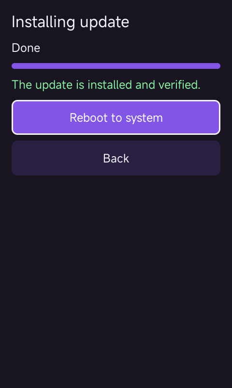
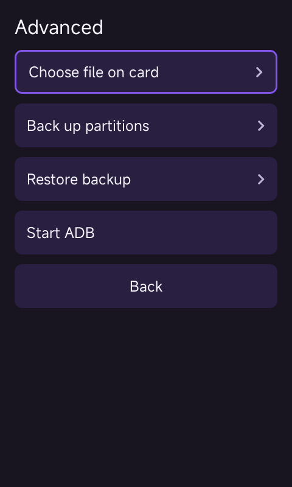
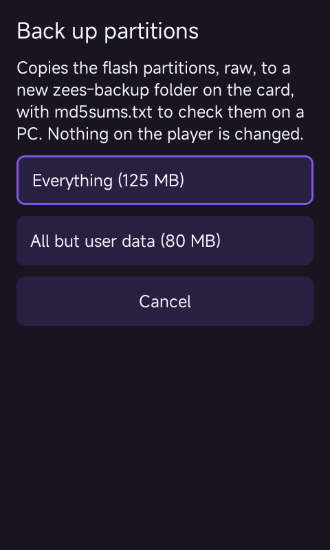

# Zee's Recovery

A replacement for HiBy's recovery app (`recoveryd`). It installs firmware
from the microSD card, backs up and restores the flash, does factory resets,
and can install a custom bootloader for USB fastboot support (no more cloner).

It's a small LVGL app, controlled by touch or the side keys.

<p>
  
  
  
  
  
</p>

For internals, build details and the PC simulator, see
[ADVANCED.md](ADVANCED.md).

## Entering the recovery

Hold **Volume up** while powering on. It also starts automatically when the
player installs an update, or after `fastboot reboot recovery`.

## Controls

| Key | Action |
|---|---|
| Volume up / down | move |
| Play/Pause | select |
| Power | back |
| Next (R1) | move down |

## Menu

| Main menu | |
|---|---|
| Install r1.upt | installs `<model>.upt` (e.g. `r1.upt`, `r3proii.upt`) from the top folder of the card |
| Factory reset | erases `/data`, optionally keeping the music library |
| Advanced | more options, below |
| Reboot to system | |
| Power off | |

| Advanced | |
|---|---|
| Choose file on card | pick any `.upt` file on the card |
| Back up partitions | copies the whole flash to a `zees-backup-*` folder on the card |
| Restore backup | writes partitions back from a backup; you pick which (the bootloader only after a warning) |
| Reboot to fastboot | only with Zee's bootloader |
| Install fastboot | installs Zee's bootloader (shown while HiBy's is installed) |
| Wipe OTA partition | erases the `ota` partition (boot record, fastboot request, boot logo choice); the player then starts the system |
| Start ADB | |

Good to know:

- The card is read-only, except while a backup is being written.
- Updates are refused below 20% battery unless the player is charging.
- Every update is verified after writing. If it fails, the player keeps
  starting the recovery instead of a broken system.

## The charger

The recovery boots without changing how the battery is charged, and touches
nothing of the main system's: all of this is in `overlay/`, which only the
recovery's root fs gets.

On the R1 the charger is the AXP2101 PMIC. Its driver's probe writes the
charger registers whenever it loads (with the stock `axp2101.sh`, a 4.40 V
end of charge voltage, and its own charge current, input current limit,
precharge and termination); on the main system Sonix Player puts its own
back a few seconds later, in the recovery nothing would. So the R1's
`driver_default_init_script.sh` runs `keep-charger.sh` (both in
`overlay/r1/module_driver/`) in place of `sh axp2101.sh`: registers 0x16,
0x61, 0x62, 0x63 and 0x64 are read over I2C before the driver loads and
written back through its `/sys/class/axp/axp_reg` afterwards, and
`usb/constant_charge_current_max` (mA) gets the same charge current, which
the driver applies again after every plug-in. The PMIC keeps its registers
over a reboot, so this is what the main system left. A charge current of 0
is not kept. The script creates no file; what it did goes to the console.

On the R3 Pro II the charger is an MP2731, which keeps nothing over a reboot:
its driver (`kernel/module_drivers/hiby/r3proii/mp2731`) resets the chip and
sets it from `mp2731.sh` every time it loads, on the main system too. The
player's charge limit is the driver's, not the chip's, so the recovery
cannot keep it; its `mp2731.sh` (`overlay/r3proii/module_driver/`, the stock
one with `charge_limit_percent=80` added) starts the driver at an 80 % limit
instead, which the driver holds from the fuel gauge on its own.

The overlays are used with the Sonix kernel (`pack_recovery.sh --kernel`,
what `build_recovery.sh` does by default); `--stock-kernel` keeps HiBy's
scripts as they are.

## Building

From the top of the repository:

```sh
./build_recovery.sh                 # R1, with the Sonix kernel
./build_recovery.sh --no-build      # repack only, using what's in output/
./build_recovery.sh --stock-kernel  # keep HiBy's kernel2, build rootfs2 only
```

The first build needs a dump of the stock recovery from your player
([how to get it](ADVANCED.md#getting-the-nand-dump)). It also downloads
and builds its toolchain, which takes a while.

The output is:

- `output/<model>/kernel2-recovery.xImage`
- `output/<model>/rootfs2-recovery.squashfs`

Only the R1 is supported for now (there's no R3 Pro II dump yet).

## Flashing

Start Zee's bootloader in fastboot (hold **Play/Pause** at power-on), then
flash **both** files together:

```sh
fastboot flash kernel2 output/r1/kernel2-recovery.xImage
fastboot flash rootfs2 output/r1/rootfs2-recovery.squashfs
fastboot reboot recovery
```

With `--stock-kernel`, flash only rootfs2.

To go back to the stock recovery, flash your dump the same way:
`~/r1-mtd/mtd3` to kernel2 and `~/r1-mtd/mtd4` to rootfs2.

## On the player

| | |
|---|---|
| App | `/usr/bin/zees_recovery` |
| Data | `/usr/share/zees-recovery/` |
| Log | `/tmp/zees_recovery.log` |
