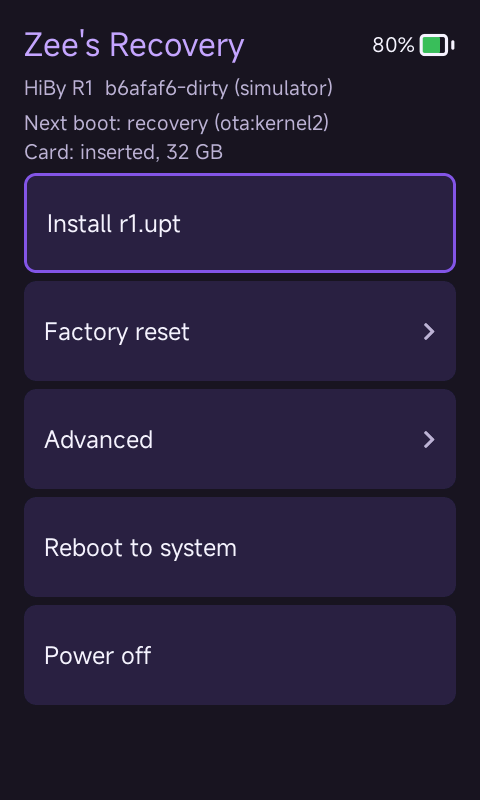
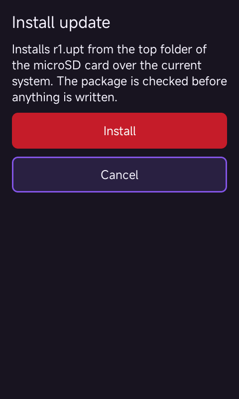

# Zee's Recovery

A replacement for HiBy's recovery app (`recoveryd`). It installs firmware
from the microSD card, backs up and restores the flash, does factory resets,
and can install a custom bootloader for USB fastboot support (no more cloner).

It's a small LVGL app, controlled by touch or the side keys.

<p>
  
  
  
  
  
</p>

For internals, build details and the PC simulator, see
[ADVANCED.md](ADVANCED.md).

## Entering the recovery

Hold **Volume up** while powering on. It also starts automatically when the
player installs an update, or after `fastboot reboot recovery`.

## Controls

| Key | Action |
|---|---|
| Volume up / down | move |
| Play/Pause | select |
| Power | back |
| Next (R1) | move down |

## Menu

| Main menu | |
|---|---|
| Install r1.upt | installs `<model>.upt` (e.g. `r1.upt`, `r3proii.upt`) from the top folder of the card |
| Factory reset | erases `/data`, optionally keeping the music library |
| Advanced | more options, below |
| Reboot to system | |
| Power off | |

| Advanced | |
|---|---|
| Choose file on card | pick any `.upt` file on the card |
| Back up partitions | copies the whole flash to a `zees-backup-*` folder on the card |
| Restore backup | writes partitions back from a backup; you pick which (the bootloader only after a warning) |
| Reboot to fastboot | only with Zee's bootloader |
| Install fastboot | installs Zee's bootloader (R1 only, shown while HiBy's is installed) |
| Start ADB | |

Good to know:

- The card is read-only, except while a backup is being written.
- Updates are refused below 20% battery unless the player is charging.
- Every update is verified after writing. If it fails, the player keeps
  starting the recovery instead of a broken system.

## Building

From the top of the repository:

```sh
./build_recovery.sh                 # R1, with the Sonix kernel
./build_recovery.sh --no-build      # repack only, using what's in output/
./build_recovery.sh --stock-kernel  # keep HiBy's kernel2, build rootfs2 only
```

The first build needs a dump of the stock recovery from your player
([how to get it](ADVANCED.md#getting-the-nand-dump)). It also downloads
and builds its toolchain, which takes a while.

The output is:

- `output/<model>/kernel2-recovery.xImage`
- `output/<model>/rootfs2-recovery.squashfs`

Only the R1 is supported for now (there's no R3 Pro II dump yet).

## Flashing

Start Zee's bootloader in fastboot (hold **Play/Pause** at power-on), then
flash **both** files together:

```sh
fastboot flash kernel2 output/r1/kernel2-recovery.xImage
fastboot flash rootfs2 output/r1/rootfs2-recovery.squashfs
fastboot reboot recovery
```

With `--stock-kernel`, flash only rootfs2.

To go back to the stock recovery, flash your dump the same way:
`~/r1-mtd/mtd3` to kernel2 and `~/r1-mtd/mtd4` to rootfs2.

## On the player

| | |
|---|---|
| App | `/usr/bin/zees_recovery` |
| Data | `/usr/share/zees-recovery/` |
| Log | `/tmp/zees_recovery.log` |
